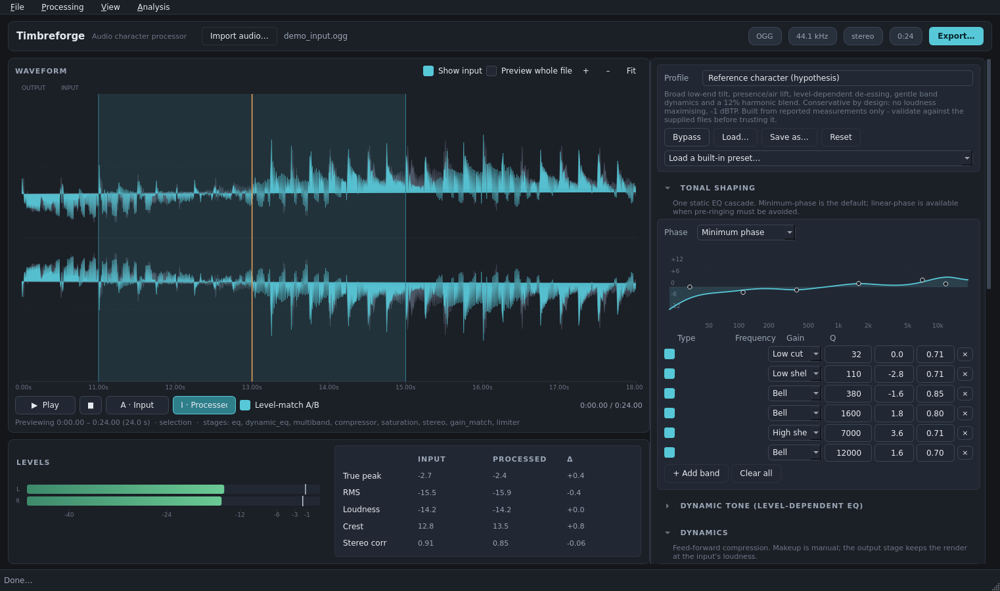

# Timbreforge

A standalone desktop audio-character processor: import a file, preview a
non-destructive processing graph, compare it against the untouched input at
matched loudness, and export through a Save-As dialog.

It exists to reproduce one specific goal — the *tonal and textural* character of
the reference recording (`NewTest.ogg`) using ordinary material — **without**
pitch, tempo or speed changes, and **without** becoming a loudness maximiser.



---

## Status: read this first

**The reference files are not in this repository.** `NewTest.ogg`,
`newtestmodified3.ogg`, `TestSong.ogg` and `newtestoriginal3.ogg` were not
supplied with the workspace, so:

* nothing in this repo is a *verified* measurement of those files;
* the shipped profile (`profiles/reference_character.json`) is a **hypothesis**
  built from the figures the previous investigation reported, plus the quality
  rules in the brief. It is deliberately conservative and is *not* claimed to be
  a reproduction;
* every number in `examples/` was produced from synthetic demo material and is
  labelled as such.

The analysis tooling in this repo is what turns the hypothesis into evidence.
Drop the four files next to this README and run the commands in
[Reference analysis](#reference-analysis) — that produces the verified report,
the method comparison and a fitted starting-point profile. See
`docs/ANALYSIS.md` for what has and has not been established.

---

## Install and launch

Requires Python 3.10+.

```bash
python -m pip install -r requirements.txt

./run.sh                 # macOS / Linux
run.bat                  # Windows

# or directly
python -m timbreforge
python -m timbreforge "/path/to/song.ogg"   # open with a file loaded
```

Packages used: `numpy`, `scipy`, `soundfile` (libsndfile), `PySide6`.
`matplotlib` is only needed for the analysis figures. Nothing else is required —
no Audacity, no Discord/bot configuration, no network access.

Audio monitoring: the app uses Qt Multimedia when the PySide6 build provides it,
falls back to `sounddevice`, and if neither is available it says so and keeps
working (rendering, measurement and export are unaffected). On a bare Linux box
install `libportaudio2` (for sounddevice) or use a full PySide6 wheel.

---

## Using the app

1. **Import** — `File ▸ Import` (Ctrl+O), drag a file onto the window, or pass it
   on the command line. WAV, FLAC, Ogg Vorbis and MP3 are supported through
   libsndfile (ffmpeg is used as a fallback decoder if installed).
2. **Preview** — the render happens on a worker thread. Files longer than 45 s
   preview a 30 s window around the playhead (tick *Preview whole file* to render
   everything). Drag on the waveform to select a region; double-click clears it.
   `Ctrl` + wheel zooms, wheel scrolls, `F` fits.
3. **A/B** — buttons `A · Input` / `B · Processed` swap what you hear without
   losing the playhead. *Level-match A/B* attenuates the louder side (never
   boosts) so the comparison is honest. `Bypass` in the profile panel renders
   the input through the same path for a bit-identical reference.
4. **Adjust** — every control edits one parameter of the one processing graph
   (see below). Re-renders are debounced; the status line lists the active
   stages and any level-matching applied.
5. **Export** — `Export…` (Ctrl+E) picks format, bit depth/quality, sample rate
   and destination, renders the **whole** file with the same engine, then
   re-decodes the written file and reports timing, true peak, loudness, crest,
   correlation and any clipping. The imported file can never be overwritten;
   an existing destination asks first; cancel leaves no partial file behind.
6. **Profiles** — `Save as…` / `Load…` store the complete graph as JSON.
   Three are shipped in `profiles/`:
   * `neutral_level_matched.json` — no processing, level matched, −1 dBTP
   * `gentle_character.json` — broad tilt + one soft compressor
   * `reference_character.json` — the hypothesis (loaded at startup)

---

## The processing graph

One graph, used by preview and export alike, in a fixed order:

| # | Stage | What it does | Why it sits there |
|---|---|---|---|
| 1 | Static EQ | Up to N RBJ biquads, minimum phase by default, linear-phase FIR option | tone first, so later dynamics react to the intended balance |
| 2 | Dynamic EQ | level-dependent peaking bands (de-esser style) | tonal change that only happens on loud material |
| 3 | Transient shaping | attack/sustain gain curve | before compression, or the compressor undoes it |
| 4 | Multiband dynamics | per-band compression around a complementary linear-phase crossover | band-dependent density |
| 5 | Broadband compressor | feed-forward, RMS or peak detector, linked or independent | overall density; manual makeup only |
| 6 | Saturation | oversampled waveshaping, level-compensated by attenuation only | after the dynamics, so it is not gain-modulated |
| 7 | Stereo width | side-signal gain only | mono sum stays bit-identical |
| 8 | Output trim | user gain | an explicit decision, not automatic |
| 9 | Loudness match | brings the render to the **input's** loudness (≤, capped at ±18 dB) | A/B fairness; the default cannot get louder |
| 10 | True-peak limiter | offline look-ahead, −1 dBTP default | the last thing before the file is written |

Guarantees enforced by code and checked by tests:

* **No pitch, tempo, speed or time-stretch anywhere.** Output length equals input
  length exactly (`render()` raises if it does not). The only length difference
  in an export is container padding from the codec, which is reported.
* **Not a loudness maximiser.** The loudness match only attenuates by default;
  positive output trim is a deliberate user action. Lossy overshoot is caught by
  re-measuring the encoded file.
* **Transparent where it should be.** With neutral settings the multiband stage
  sums back to the input to within 1e-16, the stereo stage leaves the mid signal
  bit-identical, and the whole graph at default settings is level-match + limiter.
* **Mono compatibility** is measured (mono fold-down change is reported).

---

## Reference analysis

With `TestSong.ogg` (original) and `NewTest.ogg` (processed) present:

```bash
# 1. Is it the same recording, and what actually differs?
python tools/analyze_pair.py --original TestSong.ogg --reference NewTest.ogg \
    --out-dir analysis/NewTest --figures

# 2. Compare processing families at matched loudness
python tools/compare_methods.py --original TestSong.ogg --reference NewTest.ogg \
    --out analysis/method_comparison.md

# 3. Optional: same, for the second pair
python tools/analyze_pair.py --original newtestoriginal3.ogg \
    --reference newtestmodified3.ogg --out-dir analysis/NewTest3 --figures
```

The same analysis is available inside the app under `Analysis ▸ Reference pair
analysis…`, where it can also fit a starting-point EQ profile from the measured
apparent transfer.

What the analysis reports, and why each part exists:

* **same recording?** — normalised correlation at the measured lag, per-segment
  lag spread (drift), and a tuning estimate from the spectra. Duration alone is
  never used as proof.
* **alignment** — a waveform search over the full plausible range with a
  parabolic sub-sample refinement, cross-checked against an onset-envelope
  correlation, with an explicit ambiguity flag for repetitive material.
* **tuning** — the frequency ratio that best aligns the two log-spectra, so a
  genuine pitch shift or stretch shows up as cents ≠ 0.
* **levels, dynamics, stereo, spectrum** — the same measurements applied to both
  files, plus the reference re-measured at the original's loudness so gain does
  not dominate the comparison.
* **static or level-dependent?** — band ratios per loudness quartile with the
  overall gain removed. A static filter gives the same pattern at every level; a
  dynamic or nonlinear process does not. This is the test that separates "EQ" from
  "EQ + something that only happens when it is loud".
* **level relation** — the slope of reference level versus original level
  (compression signature) and the implied ratio.

---

## Tests

```bash
python tests/test_dsp.py          # graph invariants (pitch/length, loudness, limiter, stereo, export)
python tests/test_analyze.py      # analysis recovers a known lag, EQ, compression, pitch error
python tests/test_gui_smoke.py    # headless UI: import, render, A/B, export, close
```

`test_gui_smoke.py` needs a display or `QT_QPA_PLATFORM=offscreen`. On a machine
without the Qt platform libraries (missing libGL/libEGL/libDBus) the GUI tests
cannot run at all — that is an environment limit, not an app failure.

---

## Layout

```
timbreforge/
  dsp/        audio.py  meter.py  biquad.py  dynamics.py  nonlinear.py
              stereo.py  graph.py  analyze.py      <- the whole engine
  gui/        app.py  main_window.py  panel.py  controls.py  widgets.py
              player.py  workers.py  export_dialog.py  analysis_dialog.py  theme.py
  cli.py      headless render / measure / compare
tools/        make_demo.py  analyze_pair.py  compare_methods.py  render_example.py
profiles/     neutral_level_matched.json  gentle_character.json  reference_character.json
examples/     demo render, level-matched A/B, validation report, spectrograms
docs/         ANALYSIS.md (findings vs hypotheses)  METHODS.md (families tested)
tests/        test_dsp.py  test_analyze.py  test_gui_smoke.py
```

---

## Known limitations

* **Untested file size.** Everything is float64 in memory: a 2.5 minute stereo
  file needs roughly 1 GB of peak RAM during export with all stages enabled
  (measured 1.07 GB / 149 s). Preview windows keep editing responsive.
* **Lossy codecs.** Ogg Vorbis and MP3 overshoot the requested true-peak ceiling
  slightly (measured −2.25 dBTP against a −2.37 dBTP render). The export report
  says so; lower the ceiling if you need a hard guarantee in a lossy file.
* **No exact reference match is claimed** and none may be achievable: the
  reference's reported density (crest ≈ 2.6 dB, most samples near full scale)
  can only be reached with the loudness maximising this project refuses. The app
  implements the closest controlled, non-harsh result instead.
* **Ogg writing** is done in blocks because this environment's libsndfile
  segfaults on a single very large Vorbis write (reproduced above 2^22 samples).
  The block writer keeps long exports working.
